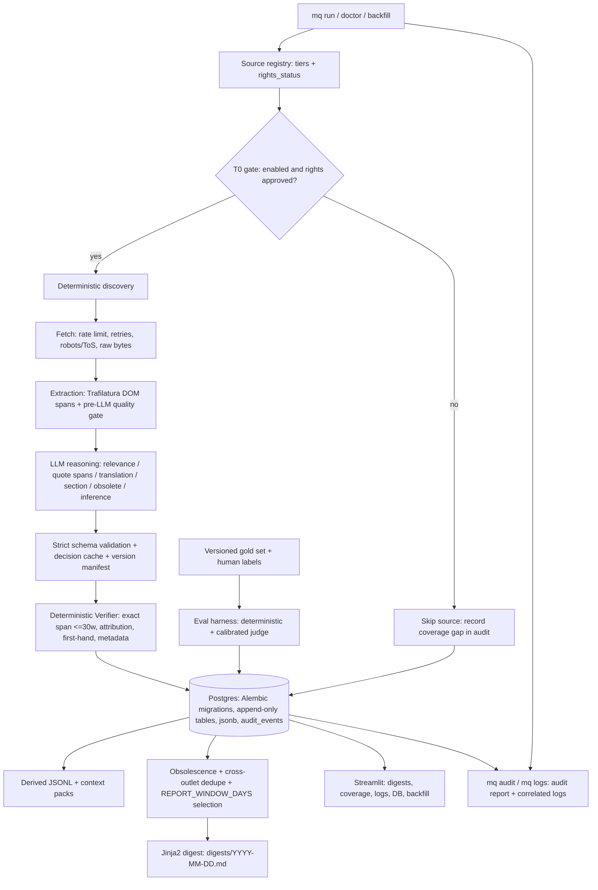

# 02 — Stack and architecture (integrated design)

This is the working design: [01](01-requirements-analysis.md) states *what*, this states
*how*, [03](03-work-breakdown.md) states *in which order*. The mandatory-sources constraint
and the Dagster choice are explained in [06](06-observations.md); decisions and accepted
risks in [04](04-risks-and-open-questions.md); per-source detail in [07](07-sources.md);
requirement→decision→task→check mappings in [08](08-traceability.md).

## 1. Stack and package mapping

| Layer | Choice | Packages (extra) | Rationale |
|---|---|---|---|
| Language | Python 3.12, Pydantic v2 **strict mode**, ruff, mypy | core (`pydantic`, `pydantic-settings`) + `dev` | Typed strict boundaries; `'123'` not coerced; validation failures logged. |
| Orchestration | Dagster daily partitions, asset checks, `code_version` | `orchestration` | Backfills, lineage, fault isolation; prompt/schema changes invalidate downstream assets. |
| Source registry | `data/sources.csv` + Postgres `sources`, T0 gate | core | Enums in [01](01-requirements-analysis.md) §2; disabled sources never contacted. |
| Discovery | httpx, feedparser, sitemap parser, GDELT/Guardian/NYT APIs where permitted; robots/ToS gate | `extraction` | Deterministic enumeration; tier cadence (6h/24h); every check traced. |
| Extraction | trafilatura `bare_extraction()`/`Document` or XML/TEI + selectolax + Playwright fallback | `extraction` | DOM spans, formatting; precision-first + `prune_xpath`, recall fallback; `reset_caches()`; quality gate before LLM. |
| Verification | NFC/smart-quote/whitespace exact-span + deterministic junk/metadata/first-hand gates | core | Fail closed `unverified`; no frankenquotes or hallucinated sources. |
| LLM | OpenAI structured outputs, pinned snapshot (PydanticAI adapter optional), content-addressed cache, Batch API | `llm` | Replayable reasoning; provider boundary swappable. |
| Evaluation | Pydantic Evals-style harness; deterministic metrics + calibrated judge; Ragas optional | `eval` | Built in task T0/T8; **never** OpenAI Evals (went read-only 2026-10-31, shuts down 2026-11-30). |
| System of record | Postgres `jsonb` + append-only provenance tables | core (`SQLAlchemy`, `psycopg`) | Indexable, auditable; `json` avoided (whitespace/key order lost, updates lock rows). |
| Schema migrations | **Alembic**, the only way to change the DB schema; `bootstrap.py` is dev-only and delegates to `alembic upgrade head` (DEC-15) | core (`alembic`) | Repeatable, reviewable changes across dev/CI/prod; `alembic_version` marker complements the audit manifest. Not required by Postgres itself — chosen because we use SQLAlchemy. |
| Dependency management | **`uv`** with committed `uv.lock` (DEC-16) | `dev` | Reproducible resolves; `uv sync --frozen` in CI/prod; no floating `>=` resolution at deploy. |
| Derived artifacts | JSONL + generated chunk/context packs (UTF-8, no BOM, one JSON value/line, `.jsonl`) | `export` built-in | Generated from Postgres only; schema at `data/quotes.schema.json` (frozen, hashed). |
| Categorisation / obsolescence | Allow-listed sections, stored rationale, lexical retrieval first; vector later | core | Deterministic MD load; obsolete filtered but retained. |
| Rendering | Jinja2 → `digests/YYYY-MM-DD.md` (canonical MD path) | `render` | Deterministic template, snapshots with ID/date matchers. |
| Dashboard | Streamlit, `st.cache_data(ttl=...)` data, `st.cache_resource` connections only | `dashboard` | Latest/archive digests, coverage, logs, DB explorer, backfill. |
| Audit / logging | structlog JSON logs, `audit_events`, `TracerProvider` + `BatchSpanProcessor`, OTLP | core (`opentelemetry-*`), `dev`/`test` for capture | One trace per article; `trace_id` end-to-end. |
| Operator commands | `mq` (`python -m media_quotes.cli`) + thin `make` wrappers | core | One easy command for run/audit/logs/eval. |
| Testing | pytest + VCR.py + syrupy + Dagster asset checks | `test` | Offline replay, frozen snapshots, data contracts. |
| Quality tooling | ruff (format + lint), `mypy --strict`, `make check` | `dev` | Enforced in CI (CHK-10); 85% coverage minimum (CHK-12). |
| Delivery | Docker Compose, GitHub Actions CI, README/runbook | `dev` | Reproducible, matches GitHub requirement. |

Install for development: `uv sync --group dev` (resolve with `uv lock`, committed).
CI/prod: `uv sync --frozen --group dev`; add feature extras only when needed. Alembic and `uv` are **implemented standards**
(T1); current scaffold state is in the root README.

## 2. Architecture

While Reuters/BBC are blocked (DEC-01) the T0 gate leaves them disabled: the pipeline reports
them as coverage gaps and is exercised with VCR fixtures; licensed-route adapters (Factiva,
Nexis, LSEG, Reuters Connect) are the live path once rights are recorded. GDELT/Guardian/NYT
are discovery only, never substitutes for the mandatory sources.

## 3. Data model

Revision `0001_initial` (`src/media_quotes/db/schema.sql`) establishes the 9 core tables (`sources`, `pipeline_runs`, `articles`, `quotes`, `llm_decisions`, `quote_classifications`, `obsolescence_flags`, `digests`, `audit_events`); follow-on Alembic revisions in T1–T8 split out dedicated `raw_blobs`, `source_checks`, `verifier_results`, `eval_runs`, and `derived_exports` tables and enable monthly declarative partitioning by `created_at` (DEC-19).

| Append-oriented table | Key fields |
|---|---|
| `sources` | source_id, tier, cadence_hours, rights_status, access_mode, license_reference, discovery_method, source_type, country_region, claim_only, enabled, notes — enums per [01](01-requirements-analysis.md) §2 |
| `pipeline_runs` / `source_checks` | run_id, REPORT_DATE/window, source_id, status, counts (`stats` jsonb), errors, `trace_id`, versions, exit status |
| `raw_blobs` | content_hash (SHA-256 of raw bytes), source_url, fetched_at, raw bytes, access_mode, immutable |
| `articles` | article_id, canonical_url, title, publication_date, byline, extracted_text + offsets, content_hash, extractor version, `trace_id` |
| `quotes` / `quote_candidates` | quote_id, canonical_quote_id (`Q-YYYYMMDD-NNNN`), article_id, raw/normalised text, char_start/end, DOM path, attribution span, **first-hand evidence** (wire-copy similarity + byline record), content_hash (SHA-256 over `source_id`, `canonical_url`, `quote_text_original`, `char_start`, `raw_blob_hash`) |
| `llm_decisions` | decision_id, **model snapshot + provider/SDK version**, schema hash, prompt version **+ template hash**, tool definitions, decoding params, **judge model snapshot**, extractor version, **app/CLI version**, **gold_set_version**, **registry version**, raw provider response id, input_hash, output JSON |
| `verifier_results` | quote_id, span match, metadata checks, junk checks, first-hand check, status (`verified`/`unverified`), verifier version (stored in `quotes.verification_details` in `0001_initial`) |
| `quote_classifications` / `obsolescence_flags` | quote_id, section, rationale, is_obsolete, obsolete_reason, `superseded_by`, decision_id |
| `digests` | digest_date (`REPORT_DATE`), window_start/end, md path (`digests/…`), template hash, generation manifest (jsonb) |
| `audit_events` | run_id, step, status, counts, errors, timestamps, `trace_id`, `license_reference` |
| `gold_set_labels` / `eval_runs` | gold_set_version, split (train/dev/test), article/quote IDs, spans, human labels (double-labelled subset), judge labels, metrics, calibration κ |
| `derived_exports` | export type (`jsonl`/context pack), source query hash, schema hash, generated_at, path |

Every append-only row carries `run_id`, `content_hash`, version fields and provenance. Use
`jsonb`, not `json`; corrections are new rows, never edits. JSONL/context packs are generated
from these tables; the frozen schema lives at `data/quotes.schema.json` (hash recorded in the
manifest).

## 4. Key mechanisms and data contracts

- **T0 gate:** contact a source only if `enabled=true` and rights cover machine retrieval,
  storage, LLM/RAG grounding and verbatim republication; `license_reference` in every log.
- **Coverage contract (dashboard data contract):** one row per enabled source per day with
  `source_id`, `expected_articles`, `discovered`, `processed`, `quotes`, `last_check_at`,
  `status` (`ok | degraded | blocked | error`), `gap_reason`. Expected count derives from the
  source's enumeration; allowed gap reasons are `rights_blocked`, `paywall`, `fetch_error`,
  `low_quality_extraction`, `no_coverage`. Freshness SLA = tier cadence (6h/24h); missing
  rows are treated as failures, not silence.
- **No frankenquotes & ≤ 30-word limit:** offsets into extracted text + exact normalised substring match;
  contiguous self-contained spans of 20 chars ≤ length ≤ 30 words (DEC-10);
  disjoint spans, ellipses middle-truncation, empty metadata and unverified first-hand flags rejected.
- **Two-stage verification:** Stage 1 applies deterministic DOM extraction and quality/junk filters before the LLM;
  Stage 2 applies the strict exact-span, ≤30-word DEC-10 limit, speaker attribution, translation and first-hand verification gates to any candidate before database insertion or publication.
- **Strict validation & pinning:** Pydantic v2 strict at every boundary; schema/prompt snapshot
  tests; full version manifest in every decision and audit row.
- **Decision cache:** keyed on (source hash + extractor version + prompt version + schema hash
  + model snapshot + decoding params); idempotent upserts; Batch API keyed by `custom_id`.
- **Extraction quality gate:** precision-first, recall fallback, rendering fallback *before*
  LLM; `reset_caches()` in long-lived workers.
- **First-hand verification:** wire-copy similarity check + byline/attribution recorded per
  article; `original_reporting_flag` set from evidence, not assumed from tier.
- **Obsolescence:** a quote is superseded when a later rights-cleared, first-hand source
  contradicts/replaces its fact; store `obsolete_reason` + `superseded_by` + decision id;
  ambiguous flags go to human review within 1 working day; precision measured on held-out set.
- **Evaluation:** thresholds and 60/20/20 split in [01](01-requirements-analysis.md) §6 #15
  and §7; deterministic metrics + κ-calibrated judge; fail-closed below threshold.
- **Observability:** one OTel trace per article, nested spans, semantic attributes
  (`run_id`, `source_id`, `article_id`, `content_hash`, `trace_id`), `record_exception`/
  `set_status(ERROR)`; JSON logs retained per policy.
- **Deterministic rendering:** Jinja2 copies quote text verbatim to `digests/YYYY-MM-DD.md`;
  only section inferences are LLM-generated.
- **Registry sync:** `data/sources.csv` is authoritative at commit; bootstrap mirrors it
  into the Postgres `sources` table; sync is CSV → Postgres only; `mq doctor` verifies
  equality and fails on drift.
- **Retention (defaults, confirmed at T1):** raw blobs 180 days, JSON logs 90 days,
  audit/decision/verifier rows indefinite (append-only), derived exports regenerable on
  demand. Configurable via `RETENTION_*` settings; enforced by a T8 asset check.
- **Capacity & cost model:** cost = articles/day × (1 relevance call + ~N quote calls) ×
  pinned-model price; the 2026-10-01→today backfill is bounded by the decision cache and
  Batch API pricing. Measure articles/day per source at T2 and record the estimate in each
  `mq eval` report so backfill cost is predicted, not discovered.
- **Backfill estimate band (planning assumption, not measured):** ~26 active outlet rows ×
  ~10–50 articles/day × ~50 days = ~13k–65k articles; at ~2 LLM calls/article that is
  ~26k–130k calls, reduced by the decision cache and Batch API. Treat as an order-of-
  magnitude envelope only — T2 measurement replaces it.
- **HTTP & concurrency:** async `httpx.AsyncClient` with an explicit `Timeout`, `Limits`,
  a polite identifying `User-Agent` from config, and a per-source token-bucket rate limiter
  at tier cadence; no unbounded parallelism. Status and rights checks pass before any
  response body is parsed.
- **Errors & retries:** one exception hierarchy rooted in `MediaQuotesError` (config, rights,
  fetch, extraction, verification, LLM); always `raise ... from err`; never bare `except`;
  `tenacity` retry with exponential backoff + jitter **only** for transient network/5xx
  failures — validation and rights-gate failures are never retried. Every failure maps to
  an audit row with error code and `trace_id`.

### 4.1 Canonical tool parameters

Single source of truth for parameters referenced by [01](01-requirements-analysis.md) §6;
changes are recorded in [08](08-traceability.md) with the affected checks.

- **Trafilatura:** `bare_extraction()`/`Document` or XML/TEI; `include_formatting=True`,
  `include_links=True`, `with_metadata=True`, source URL passed;
  `include_comments=False`, `include_tables=False`; `favor_precision=True` + `prune_xpath`
  for nav/footer contamination; `favor_recall=True` fallback when text is missing;
  `reset_caches()` in long-lived workers; low-quality output → Playwright rendering fallback
  **before** any LLM reasoning.
- **Decision cache key:** `(source content hash + extractor version + prompt version + schema hash + model snapshot + decoding params)`; idempotent Postgres upserts; Batch API keyed by `custom_id`.
- **OTel:** `TracerProvider` + `BatchSpanProcessor`; nested spans per article; semantic
  attributes `run_id`, `source_id`, `article_id`, `content_hash`, `trace_id`;
  `record_exception` + `set_status(ERROR)` on failures; OTLP export to the local collector
  (DEC-07).
- **Secrets & redaction:** credentials only via env/`.env` (with a committed empty
  `.env.example`); structlog processor redacts `api_key`, `token`, `authorization`,
  `password`, `secret` from logs and spans; VCR cassettes are filtered before commit;
  CI secret scanning (CHK-13). `license_reference` is deliberately **not** redacted — it
  is audit evidence.
- **Strict validation:** Pydantic v2 strict at every boundary (`'123'` is not `123`);
  validation failures logged during rollout; frozen JSON Schema + prompt snapshot tests.
- **Testing stack:** pytest fixtures/factories/parametrisation; VCR.py cassettes (record
  once, replay offline, filter secrets, re-record on source change); syrupy snapshots with
  ID/date matchers and frozen clock; Dagster asset checks/data contracts incl. coverage;
  Streamlit `st.cache_data(ttl=...)` for data, `st.cache_resource` for connections only.

### 4.2 Interface boundaries (function contracts)

Module boundaries are pure where possible; side effects happen only in the orchestrator.
Signatures are normative for T1–T10 implementation:

| Boundary | Contract | Failure mode |
|---|---|---|
| `registry.load(path) -> tuple[SourceRow, ...]` | strict-validated rows from `data/sources.csv`; T0 gate fields required | `ValidationError` → run exits 3 with row id |
| `fetch.run(source, limits) -> RawBlob` | async httpx, explicit `Timeout`/`Limits`, polite UA, token bucket | `FetchError` → dead-letter row + coverage gap |
| `extract.run(blob, params) -> ExtractedArticle` | trafilatura params from §4.1, DOM offsets preserved | low quality → rendering fallback before LLM |
| `verifier.verify(candidate, article) -> VerificationResult` | pure; NFC + span + metadata + first-hand | `unverified` → never published |
| `llm.decide(prompt, schema, cache_key) -> Decision` | pinned model/snapshot; cache before provider call | refusal/incomplete logged, fail closed |
| `render.digest(rows, template, dimensions) -> Path` | pure Jinja2 render to `digests/…` | snapshot mismatch → exit 1 |
| `audit.append(event, trace_id) -> None` | append-only row, no in-place updates | write failure → run exits 2 with partial report |

**Performance targets (set baseline at T2; owner Balgove Innovations):**

| Metric | Target | Where measured |
|---|---|---|
| Discovery→raw blob p95 per article | ≤ 5s (TBD at T2) | CHK-05 coverage rows |
| Extraction+verification p95 per article | ≤ 3s (TBD at T2) | `mq audit` span durations |
| LLM decision p95 (cached / fresh) | ≤ 0.1s / ≤ 5s (TBD at T2) | CHK-03/CHK-16 |
| Daily digest end-to-end | ≤ 30 min for measured source mix | `mq run` audit report |
| Dashboard p95 load (cached) | ≤ 1s per view | Streamlit timing check |

Targets are planning placeholders until T2 measurement; record any change in [08](08-traceability.md).

## 5. Command interface (offline fixture-replay CLI implemented today; full live pipeline in T9)

One entry point, `mq` (`python -m media_quotes.cli` via `src/media_quotes/__main__.py`,
plus a console script declared in `[project.scripts]`). All implemented subcommands (`doctor`,
`validate`, `bootstrap`, `run`, `audit`, `logs`, `eval`, `backfill`, `digest`, `export`, `sources`,
`version`, `dashboard`, `dagster`, `review`, `retention`, `restore-drill`) are available today in
deterministic offline fixture-replay mode; `dagster` prints setup guidance for the optional asset.
T9 wires `run`, `audit`, `logs`, `eval`, and `backfill` to live Postgres, Dagster partitions,
and the pinned OpenAI provider. `mq --help` and an import smoke test run in CI (CHK-10).

**Shared flags:** `--offline` (replay VCR cassettes; no network) · `--dry-run` (plan only, no
writes) · `--date YYYY-MM-DD` (default `REPORT_DATE`) · `--run-id` / `--trace-id` ·
`--out PATH` · `--verbose`.

**Exit codes:** `0` success · `1` validation/threshold failure · `2` partial success with
coverage gaps (audit report lists them) · `3` config/T0-gate error. Re-runs are idempotent:
same inputs (`content_hash` + versions) produce the same run/decision IDs; a re-run after an
error resumes from the last successful step and never overwrites append-only rows.

| Command | What it does |
|---|---|
| `mq doctor` | Validate config, T0 registry/`license_reference`, schema, DB, versions and templates; no network. Prints audit-ready summary. |
| `mq validate` | Validate registry/CSV, frozen JSON Schema and derived JSONL paths; **available today** via `media_quotes.validation`. |
| `mq run --date …` | **One command**: discover → fetch → extract → verify → LLM → digest → `audit` → log summary; writes run/trace IDs and `var/audit/…` report. |
| `mq backfill --from 2026-10-01 --to 2026-11-19` | Same path for an arbitrary period; Batch API + cache; idempotent. |
| `mq digest --date …` | Regenerate `digests/YYYY-MM-DD.md` from Postgres only. |
| `mq audit [--date …] [--run-id …] [--out var/audit/…]` | Deterministic checks (T0, coverage contract, schema-valid, refusal/incomplete, false-quote, exact-match, first-hand, version manifest, trace completeness) → JSON + MD report. |
| `mq logs --run-id ID [--trace-id ID]` | Correlated structured logs with `trace_id`, spans, errors. |
| `mq eval --gold-set <version>` | Deterministic metrics + calibrated judge → metrics/calibration report (κ). |
| `mq export --out data/quotes.jsonl` | Derived, versioned JSONL export. |
| `mq sources [--tier N] [--rights-status …]` | List the registry (mirrored from `sources.csv`) with rights status, access mode and coverage summary — the T0 state at a glance. |
| `mq version` | Print the version manifest (app/CLI, schema hash, prompt version, pinned model snapshot, `gold_set_version`). |
| `mq dashboard` | Launch Streamlit dashboard. |
| `mq dagster` | Print Dagster asset, partition, schedule and persistence guidance; start the UI with `scripts/run_dagster.ps1`. |
| `mq review --action list/decide [--quote-id …]` | Obsolescence review queue: list pending flags or record a human verdict (CHK-15). |
| `mq retention [--dry-run]` | Print retention/lock readiness plan; no DDL/rows touched (CHK-17 groundwork). |
| `mq restore-drill [--reference PATH]` | Compare derived exports by quote id + content hash (CHK-17/F2). |
| `make audit`, `make logs`, `make run` | Thin wrappers for non-Python users. |

`media_quotes.validation` is wired into the implemented `mq doctor`/`mq validate` commands and
`scripts/validate_data.py`. All CLI subcommands function in offline fixture replay;
T9 provides the live database, Dagster asset scheduling, and external LLM connections.

## 6. Not adopted

DEC-09 closes this: pgvector, msgspec and LangGraph are **not adopted**. The curated
JSONL context pack is the LLM context artifact; PydanticAI remains an optional adapter for
the pinned OpenAI layer. A **Neo4j integration is planned as an option, not adopted** — see
[09-neo4j-integration.md](09-neo4j-integration.md) for the graph model, sync design, validation
and rollout triggers. Revisit only if real graph queries appear or a measured JSONL/HTTP
bottleneck justifies the change (record the change in [08](08-traceability.md)).

## 7. Python engineering standards (DEC-16, planned for T1/T8; enforced by CHK-10…13)

These are **specified standards**, not claims about the current scaffold — see the root
README's \"Implemented today vs planned\". CHK-10…13 are check definitions; the CI workflow
and `Makefile` land with T1/T8.

| Topic | Standard | Where checked |
|---|---|---|
| Dependencies | `uv` + committed `uv.lock`; `uv sync --group dev` locally, `uv sync --frozen --group dev` in CI/prod; weekly `uv lock --upgrade` + dependency audit | CHK-11 |
| Format | `ruff format --check .` (line length 100) | CHK-10 |
| Lint | `ruff check .` (E, F, I, UP, B, SIM, S, RUF rules); no blanket `# noqa` without a comment | CHK-10 |
| Types | `mypy --strict src/`; untyped third-party imports get a targeted ignore with a comment; no unexplained `Any` in public signatures | CHK-10 |
| Tests | `tests/unit`, `tests/integration`, `tests/cassettes`, shared `conftest.py`; markers `integration`/`network`/`slow`; unit tests never touch network or DB; **≥ 85% coverage** on `src/media_quotes` | CHK-12, CHK-07, CHK-09 |
| Warnings | Our deprecation warnings are errors in tests; third-party warnings filtered narrowly in `conftest.py` | CHK-10 |
| Build | `python -m build` plus `mq --help` import smoke in CI | CHK-10 |
| Schema | Alembic migrations only; no ad-hoc DDL; schema version recorded in the audit manifest (DEC-15) | CHK-01 |
| Secrets | env/`.env` only; `.env.example` committed empty; structlog redaction processor; CI secret scanning; filtered cassettes | CHK-13 |
| Domain objects | frozen `@dataclass` or Pydantic models for internal values; verifier, normaliser and renderer are pure functions | CHK-12 |

**Tool config contract** (lives in `pyproject.toml`, created at T1):

| Tool | Config |
|---|---|
| ruff | `target-version = py312`, `line-length = 100`, `src = [\"src\", \"tests\"]`, lint select `E, F, I, UP, B, SIM, S`; `format` uses the same line length |
| mypy | `python_version = 3.12`, `--strict` on `src/`; untyped third-party imports use targeted `ignore_missing_imports` per module, never global |
| pytest | `testpaths = [\"tests\"]`, `--cov=media_quotes` with 85% floor in `[tool.coverage.report]`, strict markers/config, markers `integration`, `network`, `slow` |
| uv | `uv.lock` committed; dev command `uv sync --group dev`; CI/prod `uv sync --frozen --group dev` |

Single CI gate: `make check` = `scripts/docs_qa.py` + ruff format/lint + `mypy --strict src/`
+ `pytest --cov --cov-fail-under=85` + build/entry-point smoke. SECURITY: `license_reference`
is audit data and must not be redacted; API keys must never appear in logs, traces, audit
rows or cassettes.
