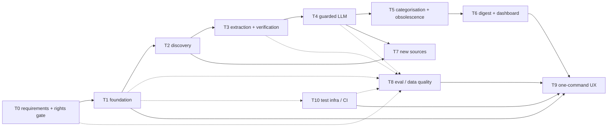

# 03 — Aggregated work breakdown

Eleven aggregated tasks (T0–T10). **Notation:** \"T0 gate\" = the rights gate in brief §1;
task `T0` = requirements lock & acceptance design. T1, T8 and T10 are prerequisites that run
continuously from T1. Requirement→decision→task→check mappings live in
[08-traceability.md](08-traceability.md); the register of decisions/risks is
[04](04-risks-and-open-questions.md); design constraints are in [06](06-observations.md).
Owner of every task is **Balgove Innovations** (specialist roles noted where needed).
Estimates are T-shirt sizes (S/M/L) for planning only, not commitments.

| ID | Aggregated task | Scope / sub-tasks | Deliverables | Depends on | Est. | Owner |
|---|---|---|---|---|---|---|
| **T0** | Requirements lock, rights gate & acceptance design | Keep Reuters/BBC **mandatory** (DEC-01) with the T0 gate: two-track rights sequence (Track A fast-tracks open/API sources, Track B commercial syndication); rights register covering machine retrieval, storage, LLM/RAG grounding, verbatim republication, backfill; `rights_status` + `license_reference`; admit tier 2/3 by brief §1.1; build **our own stratified gold set** (DEC-03: ~60–100 articles, mandatory via fixtures while blocked, Tier 3, Tier 2; 60/20/20 train/dev/test by article; article relevance, quote spans, metadata, section, obsolete labels; double-label ~20% – DEC-12); define metrics/thresholds from [01](01-requirements-analysis.md) §7 and rubric §6 #12; eval protocol with bias controls, κ calibration, pinned judge; confirm internal-only digest (DEC-02) and licence-limit policy (DEC-10) | Signed-off spec, permitted-source register, versioned gold set + split, metric/threshold definitions, eval protocol | — | M | Balgove Innovations + counsel |
| **T1** | Foundation, repo & data layer | Repo/Docker Compose/config (`REPORT_DATE`, `BACKFILL_START`, `REPORT_WINDOW_DAYS`)/secrets; **Alembic** migrations for append-only schema (dev bootstrap delegates to `alembic upgrade head`, DEC-15; BOOT-01), **monthly partitioned audit tables** (RSK-11 plan, [10](10-risk-mitigation-plan.md) §3, CHK-17); strict Pydantic v2 boundaries (align `SourceIn.source_type`, ENUM-01); frozen schema/prompt snapshots; **`uv` + committed `uv.lock`**; derived JSONL export; JSON logs + OTel `TracerProvider`/`BatchSpanProcessor` + redaction (TRACE-01, CHK-13); **CLI skeleton** (today: `mq doctor`, `mq validate`, `mq bootstrap`; T9 adds run/audit/logs dispatch, shared flags + exit codes) | Running platform, Alembic head, `uv.lock`, export contract, log/trace scaffold, CLI skeleton, `mq doctor` green | Task T0 | L | Balgove Innovations |
| **T2** | Deterministic discovery & ingestion | Sitemap/RSS/API/GDELT enumerators for **permitted** sources; tier cadence 6h/24h; T0 gate before contact; robots/ToS; async `httpx.AsyncClient` with explicit `Timeout`/`Limits`, polite `User-Agent`, per-source token bucket; `tenacity` retry with backoff+jitter for transient 5xx only; `MediaQuotesError` hierarchy; circuit breakers, dead-letter queue, dedupe; immutable raw-blob store; licensed-route adapters (Factiva/Nexis/LSEG/Reuters Connect) for mandatory sources; backfill dry-run cost estimate + `--max-cost` budget gate (RSK-08 plan, [10](10-risk-mitigation-plan.md) §2, CHK-16); every check traced; VCR cassettes for offline dev | All permitted articles for a date enumerated, raw snapshot stored, coverage contract rows written | T1, task T0 | L | Balgove Innovations |
| **T3** | Extraction, cleaning & verification | Per-source DOM-aware extractors; trafilatura `bare_extraction()`/`Document`/XML-TEI with formatting/links/metadata, source URL, no comments/tables, `favor_precision=True` + `prune_xpath`, `favor_recall=True` fallback, `reset_caches()`; DOM offsets; low-quality/empty → Playwright rendering fallback **before** LLM (DEC-08); candidate extraction selecting self-contained contiguous spans ≤ 30 words (DEC-10); deterministic verifier gating publication: exact-span match, speaker attribution, non-empty metadata, junk filters, dedupe, source match; **first-hand evidence** (wire-copy similarity + byline record); fail-closed `unverified`; obsolescence evidence bundle (RSK-07 plan, [10](10-risk-mitigation-plan.md) §1) | Verified quote records with offsets, quality metadata and first-hand evidence | T2 | L | Balgove Innovations |
| **T4** | LLM reasoning layer (guarded) | Article/quote relevance using [01](01-requirements-analysis.md) §6 #12 rubric, section assignment, obsolescence inference, multilingual translation (English translation for non-English sources preserved in `quote_text_en`); OpenAI structured outputs with pinned snapshot (DEC-05); strict schema validation, refusal/truncation handling, fail-closed status; content-addressed cache (content hash + extractor/prompt/schema/model versions + decoding params); Batch API backfills; full manifest + raw response id in audit row | Replayable classifications + rationales with pin manifest | T1, T3 | L | Balgove Innovations |
| **T5** | Categorisation & obsolescence engine | Allow-listed sections from `sections.csv`; deterministic verbatim insertion; claim ledger + lexical retrieval of newer facts; cross-outlet quote deduplication in 14-day window (earliest first-hand outlet cited); wire-copy attribution regex heuristic when wires are blocked; supersession per [01](01-requirements-analysis.md) §6 #13 (`obsolete_reason`, `superseded_by`, decision id); 1-working-day human review of ambiguous flags; rolling `REPORT_WINDOW_DAYS` selection; first-hand flag + claim labelling enforced; held-out obsolete eval set | Final quote set per section, obsolete excluded from MD but retained, auditable rationale | T3, T4 | M | Balgove Innovations |
| **T6** | Daily digest & dashboard | Jinja2 MD at canonical `digests/YYYY-MM-DD.md` (period title, sections, verbatim quotes + metadata + links, 1–2 sentence inference), scheduled for `REPORT_DATE`; DEC-10 limits enforced in renderer; Streamlit: latest/archive digests, **coverage view per [02](02-stack-and-architecture.md) §4** (expected vs discovered vs quotes, gap reasons, freshness SLA), logs, DB explorer, manual backfill, **obsolescence review queue** (evidence bundle, SLA 1 working day, approve/override with stored decision — [10](10-risk-mitigation-plan.md) §1, CHK-15); `st.cache_data(ttl=...)` data, `st.cache_resource` connections only | Daily MD + dashboard satisfying brief §3 (OUT-02/03) | T1, T5 | M | Balgove Innovations |
| **T7** | New-source onboarding & backfill automation | Generic adapter builder; T0 gate + brief §1.1 checks (first-hand sample with evidence, rights, cadence, archive) before enablement; dry-run, approval gate, auto-backfill from `BACKFILL_START`, arbitrary user periods — only where terms permit | User-driven source/period feature end-to-end | T2, T3, T4 | M | Balgove Innovations |
| **T8** | Evaluation & data quality (continuous from T1) | Eval harness from task T0; deterministic checks with **thresholds in [01](01-requirements-analysis.md) §7** (exact-match 100%, false-quote 0, schema-valid 100%, recall ≥ 0.90, span/metadata ≥ 0.95, obsolete precision ≥ 0.90, judge κ ≥ 0.70); no tuning on test split; `mq eval`; judge calibration reports; Dagster asset checks/data contracts incl. coverage (CHK-03/05); failure-injection tests for verification/LLM refusal | Tests pass, metrics + calibration report, threshold report | Task T0 onwards | L | Balgove Innovations |
| **T9** | One-command operator UX | Finish `mq` from T1: all 12 CLI subcommands implemented today in offline fixture-replay mode; T9 wires them to live Dagster/Postgres/LLM orchestration; console script + `__main__.py` with import/`--help` smoke (CHK-10); thin `make audit`/`make logs`/`make run`/`make check` wrappers; audit report (JSON + MD) with T0 approvals, version manifest, coverage gaps and trace completeness; runbook | One easy command for audits/logs/full runs; contract in [02](02-stack-and-architecture.md) §5 (OUT-05) | T1, T6, T8, T10 | M | Balgove Innovations |
| **T10** | Test infrastructure & CI (split from T8; continuous from T1) | pytest fixtures/factories/parametrisation; test layout `tests/unit`, `tests/integration`, `tests/cassettes` + `conftest.py`, markers `integration`/`network`/`slow`; VCR.py cassettes (record once, replay offline, filter secrets, re-record on source change, CHK-09); syrupy snapshots with ID/date matchers + frozen clock (CHK-04); coverage **≥ 85%** (CHK-12); `uv.lock` freshness (CHK-11); `make check` = docs_qa + ruff format/lint + `mypy --strict src/` + pytest + build + entry-point smoke (CHK-10); secret-redaction tests (CHK-13); CI secret scanning; docs-QA checklist in [docs/README.md](README.md) | `make check` green in CI, 85% coverage, frozen snapshots, filtered cassettes, redaction tests | T1 | M | Balgove Innovations |

## Acceptance criteria by task (check refs)

| Task | Exit criterion (check refs) |
|---|---|
| T0 | Gold set v1 + thresholds signed off; DEC-01/02/10 recorded (CHK-03) |
| T1 | `mq doctor` green; Alembic head; `uv.lock`; strict models; export contract (CHK-01, CHK-13) |
| T2 | Every permitted source enumerated for a day; raw blobs immutable; coverage rows (CHK-05, CHK-09) |
| T3 | Verified spans + first-hand evidence; `unverified` never published (CHK-02, CHK-07) |
| T4 | Replayable decisions with full manifest; no duplicate provider calls (CHK-02, CHK-16) |
| T5 | Obsolete excluded with rationale/reviewer verdict; claim labels enforced (CHK-03, CHK-15) |
| T6 | MD snapshots pass; DEC-10 limits in renderer; review queue works (CHK-04, CHK-15) |
| T7 | Dry-run onboarding gate; arbitrary periods backfill idempotently (CHK-01, CHK-05) |
| T8 | Gold-set thresholds; κ calibration; asset checks (CHK-03, CHK-05) |
| T9 | `mq run`/`audit`/`logs`/`sources`/`version`/`dashboard` all exit 0–3 as documented (CHK-01/02/06) |
| T10 | `make check` green; 85% coverage; redaction tests; lockfile check (CHK-10…13) |

Risk-mitigation sequencing (RSK-07/08/11) lives in [10-risk-mitigation-plan.md](10-risk-mitigation-plan.md) §4; it is not repeated here.

## Sequencing

| Phase | Tasks | Exit criterion | Est. |
|---|---|---|---|
| Design gate | Task T0 | Rights register, gold set v1, thresholds signed off | M |
| Foundation | T1, T10 (start) | Alembic head, `uv.lock`, schema, export, tracing, CLI skeleton pass `mq doctor` + `make check` | L + M |
| Ingestion core | T2 → T3 (T7 parallel) | Every permitted article stored; verified quotes with first-hand evidence; coverage rows | L + L (+ M) |
| Reasoning + presentation | T4 → T5 → T6 | Replayable decisions; digest passes snapshots and obsolete checks | L + M + M |
| Quality + operator UX | T8, T10 (continuous), T9 | Thresholds met; `mq run`/`audit`/`logs` + dashboard demonstrate brief §3–§4 | L + M + M |

- Task T0 is a hard gate: mandatory sources stay mandatory (DEC-01) but cannot be contacted
  until rights are cleared; development uses fixtures and licensed routes.
- T8 (evaluation) and T10 (test infrastructure) start at T1 and run continuously — snapshots
  and the eval harness exist before the LLM stage is trusted; T10 supplies the CI gate.
- T9 starts at T1 (CLI skeleton) and completes with T8/T10 so the minimum deliverable is
  demonstrable through one command.
- Estimates are for sequencing/resource conversations, not delivery commitments.
