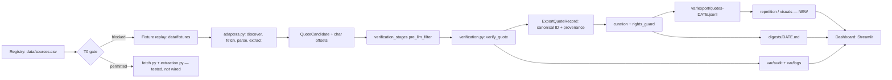

# 13 — Review, improved code overview, and feature roadmap

This document critiques the earlier overview, replaces it with a sharper picture of the code,
and expands the feature catalogue with new ideas and concrete implementation guidance.

It is descriptive, not a decision register. Anything adopted still needs a DEC/RSK row in
[04](04-risks-and-open-questions.md) and a CHK row in [08](08-traceability.md).

## 1. Critique of the previous answer

### 1.1 What was right

- The mermaid pipeline diagram matched the real flow: registry → T0 gate → fixtures →
  adapters → verification → `ExportQuoteRecord` → digest/JSONL → dashboard.
- The distinction between **real** logic (verification, T0, curation, deterministic CLI) and
  **stand-ins** (fixtures, local inference, hard-coded eval κ) was accurate.
- The two requested ideas — quote-composition visuals and repetition reports — were correctly
  identified as natural extensions because they consume the existing `ExportQuoteRecord`
  JSONL and need no live source access.

### 1.2 Where it fell short, and how this document fixes it

| # | Weakness in the previous answer | Fix here |
|---|---|---|
| 1 | Features were loose ideas with no data model | Each feature lists input fields, output artifact and file/function (§3). |
| 2 | Missed `llm_live.py`, `rights_guard.py`, `curation.py`, `batch.py` as anchors | Extension table names them explicitly (§2.2, §3). |
| 3 | No licensing implications of visuals/repetition (DEC-10 ≤30 words, attribution) | Every feature is checked against `apply_rights_limits()` / `quote_within_limits()` (§5). |
| 4 | Did not separate deterministic from LLM content | Each feature is labelled **D** or **L** with boundary (§3, §5). |
| 5 | No success metrics | Acceptance metrics / CHK-style checks added (§3, §6). |
| 6 | Ignored cost and storage growth | Cache/batch/retention notes added (§3). |
| 7 | Missed human-workflow gaps | Added review UI, gold-set authoring, verdict persistence (§3.3). |
| 8 | Missed graph/analytics despite docs/09 | Added entity resolution, corroboration, quote lifecycle (§3.2). |
| 9 | Did not explain current CLI vs planned | Added command/status table (§2.3). |
| 10 | Context packs lacked token budgeting | Added budgeted pack design with provenance (§3.1 C4). |
| 11 | No failure modes for echo analysis | R3 caveat: wire-copy syndication ≠ corroboration (§3.1). |
| 12 | Answer was transient; write failed | This file is the durable, version-controlled replacement. |

## 2. Improved code overview

### 2.1 Architecture

### 2.2 Module map (corrected)

| Module | What it really does today | Status |
|---|---|---|
| `adapters.py` | Path-confined `FixtureSource`; `SourceAdapter` discover/fetch/parse/extract; stdlib HTML parser preserving offsets; JSON fixtures. Live refs raise `NotImplementedError`. | Real replay, live stub |
| `fetch.py` | `FetchPolicy`, `TokenBucket`, `assert_fetch_permitted`, async `fetch_bytes` with SHA-256; tested with MockTransport. | Real, unwired |
| `extraction.py` | trafilatura extraction, `quality_gate`, `ExtractedArticle`, `RenderingFallback` (absent). | Real core, no fallback |
| `verification.py` | Pure fail-closed `verify_quote`: span, metadata, source identity, window, attribution, junk, policy flags. | Real |
| `verification_stages.py` | `pre_llm_filter` → `verify_pipeline` → `publishable`. No LLM stage despite name. | Real, no LLM |
| `curation.py` | `assign_section`, `group_by_section`, `dedupe_quotes`, `review_badge`. | Real |
| `rights_guard.py` | `apply_rights_limits()` enforces DEC-10 word/attribution limits. | Real |
| `registry.py`, `enums.py`, `exceptions.py` | `SourceRegistryRow` from CSV, enums, typed errors. | Real |
| `gold_set.py`, `evaluation.py` | Strict models, 60/20/20 split, `evaluate_metrics`; κ/precision stand-ins. | Real split, stand-in metrics |
| `cli/` | 16 commands, shared flags, exit codes 0/1/2/3. | Real offline |
| `orchestration.py` | Dagster daily-partitioned `daily_quotes_digest`, optional persistence. | Real, no sensors |
| `digest.py` | Deterministic Markdown: title, sections, verbatim quotes+links, obsolete hiding. | Real |
| `llm.py`, `llm_live.py` | Inference protocol + labelled stand-in; pinned OpenAI boundary unused. | Stand-in + boundary |
| `export.py` | `ExportQuoteRecord`, JSONL I/O, `content_hash`, `quote_record`. | Real offline |
| `dashboard.py` | Streamlit: digests, coverage, review queue, gaps, logs, sources, schema. | Real, file-backed |
| `db/`, Alembic | 9 append-oriented tables + 3 migrations; idempotent repository helpers. | Real |
| `risk_controls/` | Obsolescence, budget/cache, retention/partitioning, restore integrity. | Real planning |
| `batch.py`, `restore_drill.py` | Offline Batch planning; JSONL integrity. | Real offline |

### 2.3 CLI surface

`doctor`, `validate`, `bootstrap`, `run`, `audit`, `logs`, `eval`, `sources`, `version`,
`backfill --dry-run`, `digest`, `export`, `dashboard` (guidance only), `review`, `retention`,
`restore-drill`. `run` is the full offline fixture pipeline; exit 2 signals coverage gaps.

### 2.4 Data contract

1. `SourceRegistryRow` (CSV) → `policy_flags` (`source_id`, `source_tier`, `source_type`,
   `claim_only`, `requires_translation`, `source_language`, `license_reference`, …).
2. Fixture metadata → `article_text`, `quote_spans` (`quote_text`, `char_start`, `char_end`,
   `dom_path`, `speaker`, `attribution_span`, `section_id`).
3. `QuoteCandidate` → `VerificationResult` (`status`, `checks`, `reasons`, `verified_at`).
4. `ExportQuoteRecord`: `Q-YYYYMMDD-NNNN`, verbatim/translated text, source and licence fields,
   `section_id`, `is_obsolete`, `content_hash`, `verification`, offsets.
5. `RightsDecision` → `write_digest` + `write_jsonl` + audit artifacts.

## 3. Expanded feature catalogue

Legend: **D** = deterministic, **L** = LLM/non-deterministic behind the pinned provider
boundary. Every feature uses already-verified, rights-cleared records only.

### 3.1 Tier A — quick wins

| ID | Feature | Type | Input → output | Change point | Caveat / metric |
|---|---|---|---|---|---|
| V1 | Quote-composition treemap: block per section, area = quote count, colour by source tier | D | `ExportQuoteRecord[]` → SVG | new `visuals.py`; `mq visuals --kind treemap` | DEC-10 word limit on labels; SVG snapshot test |
| V2 | 14-day composition timeline: stacked bars per day by section share | D | store → SVG | `visuals.py` | uses `publication_date` |
| V3 | Quote cloud: stopword-filtered verbatim words, coloured by section | D | `quote_text_original` → SVG | `visuals.py` | never mutate text; exclude `claim_only` unless labelled |
| V4 | Attribution network: nodes speakers/outlets, edges quotes | D | speaker/source/article → SVG | `visuals.py` | mark low-confidence regex extractions |
| R1 | Exact n-gram repetition (1–5), top by section/source | D | normalised quotes → JSON+MD | new `repetition.py`; `mq repetition` | pinned stopword list; show example IDs |
| R2 | Near-duplicate clusters via MinHash/TF-IDF | D | quotes → clusters | `repetition.py` | never delete originals; calibrate threshold on gold set |
| R3 | Source echo analysis: introducer vs repeater | D | clusters + dates + `first_hand` | `repetition.py` | syndication ≠ corroboration |
| R4 | Concordance view: select phrase → all occurrences | D | all stores → search | dashboard query layer | needs index over archives |
| C1 | Per-source cards | D | audit + registry → widgets | `dashboard.py` | already partly in `coverage_summary()` |
| C2 | Coverage heatmap | D | runs/audit → SVG table | `visuals.py` + dashboard | missing rows are failures |
| C3 | Digest version diff by `quote_id` | D | two stores → MD | `cli/ops.py` new `mq diff` | stable key required |
| C4 | Context-pack builder, token-bounded with provenance | D | section quotes → pack | `cli/ops.py:_do_export` | include schema hash and token budget |

### 3.2 Tier B — analytical depth

| ID | Feature | Type | Change point | Caveat |
|---|---|---|---|---|
| A1 | Speaker entity resolution | D+L | `curation.py` + LLM | auditable alias map |
| A2 | Claim extraction/clustering | L | new `claims.py` | claim from `claim_only` never becomes fact |
| A3 | Corroboration graph | D | new `analytics.py`; optional Neo4j | state-controlled outlets not independent |
| A4 | Narrative drift detector | D | `analytics.py` + dashboard | section distribution shift |
| A5 | Anomaly/outlier quotes | D+L | `analytics.py`, optional pgvector | triage only |
| A6 | Quote lifecycle timeline | D | `risk_controls/obsolescence.py` + migration | keep obsolete stored |
| A7 | Weekly trend report | L | `digest.py` + `visuals.py` | label all inference |
| A8 | Read-only query API for frontier labs | D | new `api.py` | no secrets exposed |
| A9 | Full-text search with filters | D | `db/repository.py` + dashboard | reuse `to_tsvector` |

### 3.3 Tier C — platform and human workflow

| ID | Feature | Type | Change point | Caveat |
|---|---|---|---|---|
| U1 | Interactive obsolescence review + verdict persistence | D+L | `dashboard.py`, `cli/maintenance.py`, `obsolescence_flags` | reviewer + reason stored; 1-day SLA |
| U2 | Gold-set authoring UI | D | new label UI, `gold_set.py` | double-label ~20% |
| U3 | DB-backed dashboard explorer | D | `dashboard.py` | requires persistence on |
| U4 | Freshness/budget alerting | D | new `alerts.py` + Dagster sensor | dedupe; never leak `license_reference` |
| U5 | Batch backfill execution | D+L | `cli/ops.py:_do_backfill`, `llm_live.py` | only after rights cleared |
| U6 | Live pinned inference provider | L | `llm.make_provider`, `digest.py` | cache key already designed |
| U7 | Obsidian export with wikilinks | D | `cli/ops.py:_do_export` | derived only, answers brief |
| U8 | Audio briefing (TTS) | L | new `audio.py` | rights review for derivative output |

### 3.4 New ideas beyond the previous answer

- **N1 Quote DNA badge:** evidence strip — span ✓, attribution ✓, first-hand ✓, translation ✓,
  rights ✓ — linked to the exact DOM path.
- **N2 Confidence-preserving aggregation:** visuals/repetition use only `verified` quotes;
  `unverified` shown as a separate hatched layer, never mixed.
- **N3 What-changed-since-yesterday widget:** new / newly-obsolete / re-categorised quotes.
- **N4 Editor's notebook:** free-text annotations keyed by `quote_id`, stored as JSONL.
- **N5 Licence-compliance dashboard:** per-source limits and green/red indicator from
  `rights_guard` rejections.
- **N6 Terminology watchlist:** user terms highlit across quotes with first/last seen dates.
- **N7 Slide-deck export:** top 3 quotes per section into ODP/PPTX using pinned SVG assets.
- **N8 Evaluation leaderboard:** metrics per `gold_set_version` from `eval_runs` table.

## 4. Implementation guidance for the headline features

### 4.1 Visuals (`visuals.py`)

Public API: `treemap`, `timeline`, `wordcloud`, `attribution_graph` → SVG strings. SVG is
deterministic, snapshot-testable, Streamlit-renderable, and convertible to PNG with an
optional Pillow helper. Consume `ExportQuoteRecord` after `apply_rights_limits()`; CLI
`mq visuals --date ... --kind ... --out ...`; tests use golden SVG snapshots.

### 4.2 Repetition (`repetition.py`)

API: `ngram_report`, `near_duplicate_clusters`, `echo_analysis`. Reuse
`text_utils.normalise_text`; pin `data/stopwords.txt`; persist threshold. Output
`var/audit/repetition-<date>.json` and `digests/<date>-repetition.md`, plus a dashboard table.
Tests: synthetic repeated phrase in two sources; assert `first_hand` prevents echo analysis
from treating syndication as independent corroboration.

## 5. Guardrails

1. Never mutate `quote_text_original` or offsets; analyses produce new artifacts only.
2. Render externally only after `apply_rights_limits()` and `quote_within_limits()`.
3. Deterministic: hashes/seeds/thresholds are settings; label any LLM feature **L** and cache
   decisions by content hash.
4. Every derived artifact records generator version, input `quote_id` set and source hash.
5. Add CHK IDs to docs/08 (e.g. CHK-18 visuals snapshot, CHK-19 repetition determinism,
   CHK-20 echo-analysis safety).
6. Until T0 rights are cleared, all features consume local JSONL only.

## 6. Suggested roadmap

1. Visuals (V1–V4) and repetition (R1–R4) with SVG/JSON snapshot tests and dashboard tabs.
2. Operational polish: cards (C1), heatmap (C2), diff (C3), context packs (C4), concordance.
3. Human workflow: review UI (U1), gold-set authoring (U2), quote DNA (N1), licence view (N5).
4. Deep analytics: entity resolution, claims, corroboration, drift, anomaly, lifecycle.
5. After rights cleared: live adapters, real extraction, pinned LLM, Batch, DB dashboard, alerts.

Every step keeps the gate green: docs QA, ruff, mypy --strict, ≥85% coverage, build, CLI smoke.
