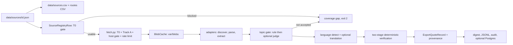

# 17 — Connection, fetching and flags reference

This is the operational reference for **how a source is connected, how articles and quotes are
fetched, and which switches control that behaviour**. It records the implementation as it
stands today, not a wish list. [14](14-command-reference.md) gives command syntax;
[16](16-topic-language-ai-judge-plan.md) gives the design rationale for the topic, language and
judge workstreams. Proposed changes are tracked in
[18](18-connection-and-fetching-improvements.md).

Owner: **Balgove Innovations**. This document is descriptive; adopting any change still needs a
decision row in [04](04-risks-and-open-questions.md) and a check row in
[08](08-traceability.md).

---

## 1. The short version

- `mq` is **offline fixture replay by default**. The only command that opens a socket is
  `mq fetch --live`.
- Live HTTP fetching goes through `fetch_bytes()` in `src/media_quotes/fetch.py`; it is used by
  `mq fetch` and by `scripts/test_scraper.py`.
- The source registry is now **file-per-source**: `data/sources/<source_id>.json`, mirrored to
  `data/sources.csv` and `data/source_topic_routes.csv`.
- A source is contacted only if its T0 rights gate passes **and** the caller passes an explicit
  Track A approval flag. Hosts are allowlisted from the source's own registered URLs, HTTPS only.
- Optional workstreams (translation, AI judge) are environment-driven, pinned to model snapshots,
  and off by default.

---

## 2. The three control layers

| Layer | Where | Typical use |
|---|---|---|
| CLI flags | `media_quotes.cli.app._build_parser` | Per-run choices: date, topic, dry-run, output |
| Environment / `.env` | `media_quotes.config.Settings` | Provider, paths, optional workstreams, persistence |
| Data files | `data/sources/`, `data/topics/`, `data/topic_rules.json` | Add or change a source or topic without code edits |

There is deliberately **no CLI flag for the inference provider** — that is environment-only.

---

## 3. `mq` flags

### 3.1 Shared flags (all subcommands)

Defined in `_add_shared` (`src/media_quotes/cli/app.py:59-67`).

| Flag | Behaviour | Actually consumed by |
|---|---|---|
| `--offline` | Deprecated compatibility flag | Accepted but ignored; every `mq` command is offline except `mq fetch --live` |
| `--dry-run` | Plan only, no files or DB rows | `run`, `backfill`, `retention` |
| `--date YYYY-MM-DD` | Report date | `run`, `audit`, `digest`, `export`, `eval`, `restore-drill` |
| `--topic <id>` | Topic pack id from `data/topics/` | `run`, `digest`, `export`, `sources add`, `topics`; falls back to `ACTIVE_TOPIC` |
| `--run-id` | Correlation id | `run`, `audit`, `logs` |
| `--trace-id` | Optional trace id | `logs` |
| `--out` | Output file or directory | `audit`, `digest`, `export` |
| `--verbose` | Extra output | `run` |

### 3.2 Per-command flags

| Command | Extra flags |
|---|---|
| `fetch` | `--source-id <id>` (required), `--limit N` (default 2), `--live` (opt into network) |
| `eval` | `--gold-set <version>`, `--split all\|train\|dev\|test` |
| `sources` | `--action list\|add\|sync-csv`, `--tier 1-4`, `--rights-status`, `--source-id`, `--name`, `--homepage-url`, `--feed-url`, `--language`, `--country-region` |
| `topics` | `--action list\|init\|show`, `--name`, `--description` |
| `backfill` | `--from`, `--to`, `--max-cost <float>` |
| `review` | `--action list\|seed\|decide`, `--quote-id`, `--verdict confirmed\|rejected\|escalated`, `--reason-code` |
| `restore-drill` | `--reference <jsonl>` |

Exit codes: `0` success · `1` validation/threshold failure · `2` partial success with coverage
gaps (expected while mandatory sources remain blocked) · `3` configuration or T0 violation.

---

## 4. Environment settings

Defined in `src/media_quotes/config.py`. Paths are resolved relative to the project root.

### 4.1 Provider (no CLI flag)

| Variable | Default | Constraint |
|---|---|---|
| `LLM_PROVIDER` | `local` | `local` or `openrouter` |
| `LLM_MODEL_SNAPSHOT` | `unset` | Must be a pinned id (not `unset`/`latest`) for OpenRouter |
| `PROMPT_VERSION` | `standalone-inference-v1` | — |
| `OPENROUTER_API_KEY` | empty | Required for OpenRouter |
| `OPENROUTER_BASE_URL` | `https://openrouter.ai/api/v1` | — |
| `OPENROUTER_APP_URL`, `OPENROUTER_APP_TITLE` | repo URL / app title | Sent as request headers |
| `OPENROUTER_TIMEOUT_SECONDS` | `30.0` | — |
| `OPENROUTER_MAX_RETRIES` | `2` | — |

### 4.2 Paths and topic selection

| Variable | Default |
|---|---|
| `ACTIVE_TOPIC` | `ukraine-war` |
| `SOURCES_DIR` | `data/sources` |
| `SOURCE_TOPICS_CSV` | `data/source_topic_routes.csv` |
| `TOPIC_RULES_PATH` | `data/topic_rules.json` |
| `TOPICS_DIR` | `data/topics` |
| `SOURCES_CSV`, `SECTIONS_CSV`, `SCHEMA_PATH`, `FIXTURES_DIR`, `GOLD_SET_DIR` | standard repo paths |
| `DIGEST_DIR`, `BLOB_DIR`, `AUDIT_DIR`, `EXPORT_DIR`, `LOGS_DIR`, `ALEMBIC_INI` | `digests`, `var/blobs`, `var/audit`, `var/export`, `var/logs`, `alembic.ini` |

### 4.3 Optional workstreams

| Variable | Default | Allowed values |
|---|---|---|
| `TRANSLATION_MODE` | `off` | `off`, `detect_only`, `translate` |
| `AI_JUDGE_MODE` | `off` | `off`, `shadow`, `advisory`, `decision` |
| `AI_JUDGE_MODEL_SNAPSHOT` | `unset` | Pinned id when judge is on |
| `JUDGE_PROMPT_VERSION` | `judge-v1` | — |
| `TRANSLATION_PROMPT_VERSION` | `translation-v1` | — |

Environment validation rules:

- `LLM_PROVIDER=openrouter` requires an API key and a pinned `LLM_MODEL_SNAPSHOT`.
- `TRANSLATION_MODE=translate` requires `LLM_PROVIDER=openrouter` and a pinned snapshot.
- Any `AI_JUDGE_MODE` other than `off` requires OpenRouter, an API key and a pinned
  `AI_JUDGE_MODEL_SNAPSHOT`.

### 4.4 Window, rights, persistence

| Variable | Default |
|---|---|
| `REPORT_DATE` | today (normally supplied with `--date`) |
| `BACKFILL_START` | `2026-10-01` |
| `REPORT_WINDOW_DAYS` | `14` |
| `GOLD_SET_VERSION` | `synthetic-v1` |
| `MAX_QUOTE_WORDS` | `30` |
| `ATTRIBUTION_FORMAT`, `LICENCE_TERRITORY`, `EXTERNAL_PUBLICATION` | internal worldwide, `false` |
| `PERSIST_TO_POSTGRES`, `DATABASE_URL` | `false`, local Postgres |
| `LOG_LEVEL`, `LOG_JSON`, `OTEL_ENABLED`, `OTEL_EXPORTER_OTLP_ENDPOINT`, `DAGSTER_HOME` | `INFO`, `true`, `false`, unset, `var/dagster` |
| `FETCH_TIMEOUT_SECONDS`, `FETCH_REQUESTS_PER_SECOND`, `FETCH_MAX_BYTES`, `FETCH_MAX_CONNECTIONS` | `10`, `1`, `5_000_000`, `10` |

`.env.example` documents every variable above, including the topic, workstream and fetch-policy
groups.

---

## 5. Live fetch surfaces

There are two live fetch surfaces: `mq fetch` (the operator command) and `scripts/test_scraper.py`
(the interactive diagnostic). Both call the same `fetch_bytes` function and the same gates.
The diagnostic script flags are:

| Flag | Default | Effect |
|---|---|---|
| `--source-id` | `guardian` | Load `data/sources/<id>.json` |
| `--topic` | `ACTIVE_TOPIC` | Topic pack for filtering and section assignment |
| `--live-feed` | off | Fetch the live RSS/sitemap, discover articles, scrape top N, verify |
| `--all-topics` | off | Disable topic filtering (`require_topic=False`) |
| `--feed-url` | from source config | Override the discovery feed URL for `--live-feed` |
| `--limit` | `2` | Max articles scraped from the live feed |
| `--validate-source <id>` | — | End-to-end ingestion health check for one source |
| `--validate-all-sources` | off | Registry, T0 and fixture/live readiness audit for all 28 sources |
| `--source-topics-csv` | settings default | Override routes CSV for validation |
| `--topic-rules` | settings default | Override rules JSON for validation |
| `--live-routes` | off | Opt in to live health checks; unapproved sources reported as `blocked_not_probed` |
| `--write-sample` | — | Write a realistic sample newspaper HTML file |
| `--html-file` | — | Scrape and verify a local HTML file |
| `--rss-file`, `--sitemap-file` | — | Test discovery from local XML (no topic filter) |
| `--live` + `--url` | — | Fetch a live URL, cache the blob, run the extraction/verification pipeline |

Mode dispatch is first-match-wins: `--validate-all-sources` → `--validate-source` →
`--write-sample` → `--live-feed` → `--rss-file` → `--sitemap-file` → `--live` → `--html-file` →
built-in demo.

Worked examples (PowerShell):

```powershell
# Live feed for an approved source, limited to two articles
.\.venv\Scripts\python.exe scripts/test_scraper.py --source-id guardian --live-feed --limit 2

# Single live article (only use a URL discovered by --live-feed)
.\.venv\Scripts\python.exe scripts/test_scraper.py --source-id guardian --live --url <article-url>

# Readiness audit, including live probes for approved routes
.\.venv\Scripts\python.exe scripts/test_scraper.py --validate-all-sources --live-routes

# Offline inspection of a local fixture or sample
.\.venv\Scripts\python.exe scripts/test_scraper.py --source-id reuters --html-file data/fixtures/reuters/synthetic-reuters-2026-11-18.html
```

---

## 6. The fetch layer

The entry point is `fetch_bytes(...)` in `src/media_quotes/fetch.py`. Its arguments are `url`,
`row`, `policy`, `track_a_approved`, and the optional `bucket`, `transport`, `clock` and
`allowed_hosts`.

### 6.1 Gates applied before any socket opens

1. **T0 + Track A** (`assert_fetch_permitted`): `track_a_approved` must be `True` and
   `row.usable` must be `True`, otherwise `SourceNotPermitted`.
2. **URL host allowlist** (`assert_url_permitted`): URL must be absolute HTTPS; host must be in
   `allowed_hosts_for(row)` (the hosts of the source's `homepage_url` and `feed_url`) plus any
   `extra_hosts`. Passing one source's rights to fetch another's host is rejected.
3. **Rate limit** (`TokenBucket`, default 1 request/second): `RateLimitExceededError` when empty.

### 6.2 FetchPolicy (strict, version-pinned)

| Field | Default | Meaning |
|---|---|---|
| `timeout_seconds` | `10.0` | httpx timeout |
| `max_connections` | `10` | httpx connection limit |
| `max_keepalive` | `2` | keepalive connections |
| `requests_per_second` | `1.0` | token-bucket refill rate |
| `max_bytes` | `5_000_000` | response size cap |
| `user_agent` | `MediaQuotesBot/0.1 (+internal research; rights-gated)` | polite UA |

`fetch_policy_from(settings)` builds this policy from the four `FETCH_*` settings, so timeouts,
rate and byte caps can be tuned without a code change. `fetch_bytes` also accepts an optional
`client`, letting a live-feed run reuse one `httpx.AsyncClient` for the feed and every article.
Redirects are not followed. The body is streamed and checked against the cap both from
`content-length` and by a running byte count, so an oversized response is rejected without
buffering it all. The return value is `(bytes, sha256)`.

Tests inject `httpx.MockTransport` and a fake clock, so the suite never touches the network.

---

## 7. Connecting a source today

Each `data/sources/<source_id>.json` carries registry fields, rights, routes and extractor hints:

- `rights_status`: `license_held`, `api_permitted`, `pending_counsel_review`, `blocked`
- `access_mode`: `licensed_database`, `official_api`, `public_rss_permitted`, `pending_review`,
  `scraped_prohibited`
- `discovery_method`: `sitemap`, `rss`, `web`, `api`, `gdelt`, `licensed_database`
- `enabled`, `license_reference`, `claim_only`, `language`, `paywalled`, `tier`, `cadence_hours`
- `routes[]`: `route_id`, `route_type`, `discovery_url`, `topic_rule_id`, `topic_id`, `priority`,
  `fallback_route_id`, `approved`, `license_reference`, `translation_rights_confirmed`, `notes`
- `extractor_hints`: `adapter` (all 28 are currently `null`), feed URL and text-quality hints

`SourceRegistryRow.usable` is true only when all of these hold: `enabled`; approved rights;
non-empty `license_reference`; permitted access mode; enumerable discovery method; discovery
method is not `web`. The Postgres schema enforces the same rule with check constraints.

Current registry state (28 sources):

| State | Count | Sources |
|---|---|---|
| Usable (`license_held`, `licensed_database`) | 10 | `ap`, `bloomberg`, `ft`, `economist`, `guardian`, `dw`, `lemonde`, `gdelt`, `guardian_api`, `nyt_api` |
| `pending_counsel_review` | 16 | all remaining outlets |
| `blocked` | 2 | `bbc`, `reuters` (mandatory but blocked under the rights gate) |

Adapter resolution order (`adapters/registry.py`): `extractor_hints.adapter` plugin → per-source
registered adapter → discovery-method adapter → base `SourceAdapter`. In practice all sources use
the discovery-method adapter. The adapters package re-exports the public symbols previously in
the deleted `adapters.py`, so callers keep working.

---

## 8. Topic, language, translation and judge controls

- **Topic pack** (`data/topics/<id>.json`): sections with keywords and stand-in summaries, plus a
  deterministic relevance rule (locale anchors, supporting terms, exclusions, weights,
  thresholds). `--topic` selects it; `ACTIVE_TOPIC` is the default.
- **Topic gate** (`relevance.py`, `pipeline.assess_topic`): a score decides `accepted`,
  `uncertain` or `rejected`. Only the `uncertain` band may reach the judge, and only in
  `AI_JUDGE_MODE=decision`. Only `accepted` quotes are published or persisted; a database check
  constraint enforces this.
- **Language detection** (`language.py`): offline `en` / `uk` / `ru` / `und` with confidence and
  evidence, stored as `quote_language` (which may differ from the source-level language).
- **Translation** (`translation.py`): off by default. `detect_only` still skips translation.
  `translate` calls the pinned provider, validates the proposal (no URLs/e-mails, no instruction
  override, plausible length ratio), and records `quote_text_en` plus provenance. A route must
  have `translation_rights_confirmed=true`; **no route currently does**, so translation skips for
  every source even when enabled. `mq doctor` prints a warning when translation mode is on but no
  route confirms that right.
- **AI judge** (`judge.py`): `off` uses a local stand-in that always escalates; `shadow`,
  `advisory` and `decision` use the pinned OpenRouter client. `decision` can override an
  obsolescence verdict only at confidence ≥ 0.80; refusal, malformed or low-confidence output
  always escalates.
- **Caching**: translation and judge decisions pass through `PinnedOpenAIClient` and the
  `decision_cache` table, keyed by content hash plus model, prompt and schema versions — never by
  `temperature=0` alone.

---

## 9. End-to-end flow



For `mq run`, the `FETCH`/`BLOB` steps are replaced by fixture replay; everything downstream is
identical.

---

## 10. What works today and what does not

- **Works:** `mq run`, `audit`, `digest`, `export`, `eval`, `sources`, `topics`, `review` in offline
  mode; `mq fetch --source-id <id>` plans a fetch and `--live` opts into network contact; live feed and
  single-article fetching through `scripts/test_scraper.py`; deterministic topic gating, language
  detection and verification.
- **Does not work yet:** translation, because no route has `translation_rights_confirmed=true`
  (the doctor warning explains this); a real LLM judge verdict (`AI_JUDGE_MODE=off` is the default
  and other modes need OpenRouter credentials).
- **Resolved:** `--offline` is now a clearly labelled deprecated compatibility flag; the README,
  `docs/12`, `docs/13` and `docs/14` no longer claim all sources are disabled or that fetching is
  unwired; `FetchPolicy` is tunable through the `FETCH_*` settings.

The plan that drove these changes, including items deliberately left for later, is in
[18](18-connection-and-fetching-improvements.md).
